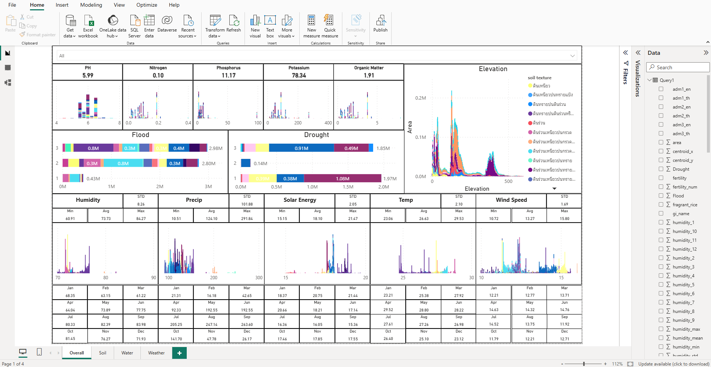

# Geospatial Intelligence Engine: Distributed Multi-Temporal NDVI Pipeline & Power BI Analytics

[](https://python.org)
[](https://www.ray.io/)
[](https://postgis.net/)
[](https://powerbi.microsoft.com/)
[]()

An enterprise-grade, distributed geospatial data pipeline and location intelligence solution. The platform automates the ingestion, raster masking, and multi-temporal Normalized Difference Vegetation Index (NDVI) extraction across millions of nationwide cadastral land parcels. Built with **Ray Core** for distributed fractional multi-processing, backed by **PostgreSQL/PostGIS**, and delivered to executive stakeholders through an interactive **Power BI Telemetry Dashboard**.

---

## 📌 Demonstration & Executive Analytics

<div align="center">
  
  <p><em>Figure: Interactive Power BI Executive Dashboard monitoring provincial crop health trajectories, parcel-level NDVI distribution, and pipeline ingestion SLA.</em></p>
</div>

The spatial analytics generated by the Ray pipeline are modeled directly into an executive-facing **Power BI Reporting Suite**, enabling data-driven decision-making across agricultural supply chains and disaster response:

* **Crop Vigor & Vegetation Time-Series:** Visualizes multi-year NDVI phenological curves to distinguish healthy growth stages from drought stress across distinct provinces.
* **Geospatial Parcel Drill-Down:** Dynamic spatial mapping highlighting parcels operating below standard historical NDVI thresholds ($\Delta \text{NDVI} < -0.15$).
* **Pipeline Telemetry & Task SLA:** Tracks ingestion progress, database row counts, and completed raster scenes per administrative province.

---

## ⚙️ Core Technical Highlights

### 1. Distributed Fractional Task Scheduling (Ray Core)
Traditional Python multiprocessing faces severe GIL bottlenecks and high memory overhead when spawning hundreds of worker processes.
* **Fractional CPU Allocation:** Each worker is scheduled with `@ray.remote(num_cpus=0.1)`, enabling a single compute node or cluster to execute **up to 10× more concurrent tasks** than physical cores.
* **Distributed Object References:** Input paths and metadata are dispatched as Ray object references, maximizing data locality and minimizing serialization overhead.
* **Cluster Scalability:** Configured with `ray.init(address="auto")` to automatically attach to multi-node clusters in production environments.

### 2. High-Performance Geospatial Masking & Dynamic Re-projection
* **Windowed Geometry Masking:** Uses `rasterio.mask` coupled with Shapely polygon geometries to isolate individual agricultural land plots without reading full raster scenes into RAM.
* **Automated CRS Synchronization:** Inspects target GeoTIFF projections dynamically, re-projecting boundary polygons on-the-fly (`gdf.to_crs(Crs)`) to preserve sub-meter coordinate precision.
* **Outlier-Resistant Statistical Aggregation:** Employs `np.nanpercentile(clipped_raster, 50)` (median) over standard mean to eliminate cloud shadows and boundary artifacts, rescaling pixel data to calibrated NDVI intervals:
$$\text{NDVI}_{\text{normalized}} = \text{round}\left(\frac{\text{Value} - 127.5}{127.5}, 2\right)$$

### 3. Enterprise Database Upserts & Memory Sanitation
* **Idempotency & Delta Verification:** Compares processed task counts against parcel totals (`check_task()`) to bypass already-processed dates (`UTD`), preventing redundant CPU cycles.
* **Bulk Vector Upserts:** Uses `psycopg2.extras.execute_values` with `ON CONFLICT (id, Date, key) DO UPDATE` to ingest thousands of parcel metrics in single atomic transactions.
* **Explicit Garbage Collection:** Enforces deterministic dataset closure (`read.close()`) and unreferenced memory sweeps (`gc.collect()`) inside task `finally` blocks, eliminating long-running memory leaks.

---

## 📂 Repository Structure

```text
distributed-geospatial-ndvi-engine/
├── config/
│   └── db_config.example.py          # Database and Ray cluster credential templates
├── docs/
│   └── powerbi_dashboard_preview.png # Power BI executive report preview
├── powerbi/
│   └── crop_health_ndvi_report.pbix  # Power BI report model and interactive visuals
├── src/
│   ├── distributed_ndvi_worker.py    # Ray remote tasks, PostGIS upserts, and raster masking
│   └── pipeline_manager.py           # Cluster resource check, batch loop, and webhook monitoring
├── requirements.txt                  # System and library dependencies
├── .gitignore                        # Excluded cache, credentials, and GeoTIFFs
└── README.md                         # Engineering case study
```

---

## 🚀 Setup & Execution

### 1. Environment Installation
```bash
git clone https://github.com/Panutle/distributed-geospatial-ndvi-engine.git
cd distributed-geospatial-ndvi-engine

python -m venv venv
source venv/bin/activate  # On Windows: venv\Scripts\activate
pip install -r requirements.txt
```

### 2. Configuration Setup
Copy the template configuration and specify your PostGIS credentials and Ray cluster endpoint:
```bash
cp config/db_config.example.py config/db_config.py
```
*(Edit `config/db_config.py` with your database credentials or export them as environment variables)*

### 3. Launching Distributed Pipeline
To start the multi-temporal ingestion and calculation loop:
```bash
python src/pipeline_manager.py
```

### 4. Viewing Power BI Reports
1. Open Power BI Desktop.
2. Open `powerbi/crop_health_ndvi_report.pbix`.
3. Update the PostgreSQL/PostGIS connection settings to point to your database host to view live refreshed telemetry.